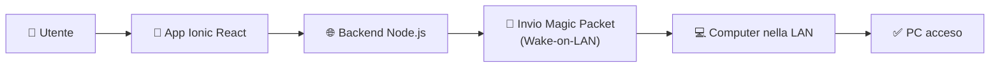
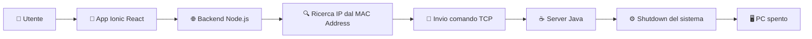

# 🚀 Wake On LAN Remote Manager


<p align="center">


</p>

<p align="center">


</p>

<p align="center">


</p>

## 📖 Overview

**Wake On LAN Remote Manager** è un progetto personale che permette di **accendere e spegnere un computer presente nella propria rete LAN anche quando ci si trova fuori casa**.

L'applicazione utilizza il protocollo **Wake-on-LAN (WOL)** per l'accensione remota e un piccolo **server Java installato sul PC remoto** per gestire lo spegnimento del sistema.

L'obiettivo del progetto è offrire un'interfaccia semplice e sicura per amministrare i propri dispositivi da remoto senza utilizzare software di desktop remoto.


<br></br>

# ✨ Funzionalità

- ⚡ Accensione remota tramite Wake-on-LAN
- 🖥️ Spegnimento remoto del PC
- 📱 Interfaccia mobile sviluppata con Ionic React
- 🌐 Backend REST sviluppato in Node.js / TypeScript
- 💾 Gestione dei dispositivi tramite MAC Address
- 🔄 Aggiornamento automatico dell'associazione MAC → IP
- 🔒 Accesso protetto da autenticazione


<br></br>

# 🏗️ Architettura

Il progetto è composto da tre componenti principali.

```text
                  Internet
                      │
                      ▼
          ┌────────────────────┐
          │  Ionic React App   │
          │ (Frontend Mobile)  │
          └─────────┬──────────┘
                    │ REST API
                    ▼
          ┌────────────────────┐
          │ Node.js Backend     │
          │ TypeScript          │
          └───────┬─────────────┘
                  │
        ┌─────────┴───────────┐
        │                     │
        ▼                     ▼
 Wake-on-LAN Packet     Java Server
    (UDP Broadcast)        (TCP)
        │                     │
        ▼                     ▼
     Computer LAN <───────────┘
```

## Frontend

L'interfaccia è stata sviluppata con **Ionic React** ed è pensata per l'utilizzo da smartphone.

L'utente può:

- visualizzare i dispositivi registrati;
- aggiungere un nuovo computer;
- accendere un PC;
- spegnere un PC;
- autenticarsi all'applicazione.


## Backend

Il backend è sviluppato in **Node.js + TypeScript** ed espone una serie di API REST.

Le sue responsabilità sono:

- gestione dell'autenticazione;
- gestione dei computer registrati;
- invio del Magic Packet Wake-on-LAN;
- individuazione dell'indirizzo IP partendo dal MAC Address;
- invio del comando di spegnimento al server Java.


## Java Server

Ogni computer controllato esegue un piccolo server Java.

Il server:

- rimane in ascolto sulla rete locale;
- riceve il comando di spegnimento dal backend;
- esegue il comando di arresto del sistema operativo.

In questo modo il PC può essere spento anche quando non è presente alcun utente davanti alla macchina.


## Aggiornamento automatico MAC → IP

Uno dei problemi principali dello spegnimento remoto è che l'indirizzo IP di un computer può cambiare nel tempo.

Per evitare configurazioni manuali, il progetto utilizza un semplice meccanismo automatico.

Ogni computer esegue uno script che:

1. effettua un **ping ogni 24 ore**;
2. aggiorna automaticamente la tabella ARP del server;
3. permette al backend di ricavare il nuovo indirizzo IP partendo esclusivamente dal MAC Address.

In questo modo il sistema continua a funzionare anche dopo il rinnovo del DHCP senza richiedere interventi manuali.

---
<br></br>

# ⚙️ Come funziona

L'intero flusso operativo è il seguente.

##  Accensione del PC




## Spegnimento del PC


<br></br>

---

# 📦 Installazione

Per la configurazione completa del progetto è disponibile la guida dedicata:

👉 **[HowToInstall.md](./HowToInstall.md)**

La guida contiene tutte le istruzioni necessarie per:

- installazione del frontend;
- configurazione del backend;
- configurazione del server Java;
- installazione degli script di supporto;
- configurazione dell'ambiente.
<br></br>

---

# 🛠️ Tecnologie

| Tecnologia | Utilizzo |
|------------|----------|
| Ionic React | Frontend |
| React | UI |
| TypeScript | Frontend & Backend |
| Node.js | REST Backend |
| Express | API |
| Java | Server remoto |
| TCP | Spegnimento remoto |
| UDP | Wake-on-LAN |
| Windows Batch | Automazione |
| Wake-on-LAN | Accensione remota |

---
<br></br>

# 🎯 Obiettivi del progetto

Questo progetto nasce con l'obiettivo di approfondire diversi aspeti dello sviluppo software, tra cui:

- progettazione di architetture client/server;
- sviluppo Full Stack;
- networking TCP/UDP;
- protocolli Wake-on-LAN;
- automazione tramite script;
- comunicazione tra applicazioni distribuite;
- progettazione di API REST.

---

<br></br>
# 📄 Licenza

This work is licensed under a
[Creative Commons Attribution-NonCommercial-ShareAlike 4.0 International License][cc-by-nc-sa].

[![CC BY-NC-SA 4.0][cc-by-nc-sa-image]][cc-by-nc-sa]

[cc-by-nc-sa]: http://creativecommons.org/licenses/by-nc-sa/4.0/
[cc-by-nc-sa-image]: https://licensebuttons.net/l/by-nc-sa/4.0/88x31.png
[cc-by-nc-sa-shield]: https://img.shields.io/badge/License-CC%20BY--NC--SA%204.0-lightgrey.svg