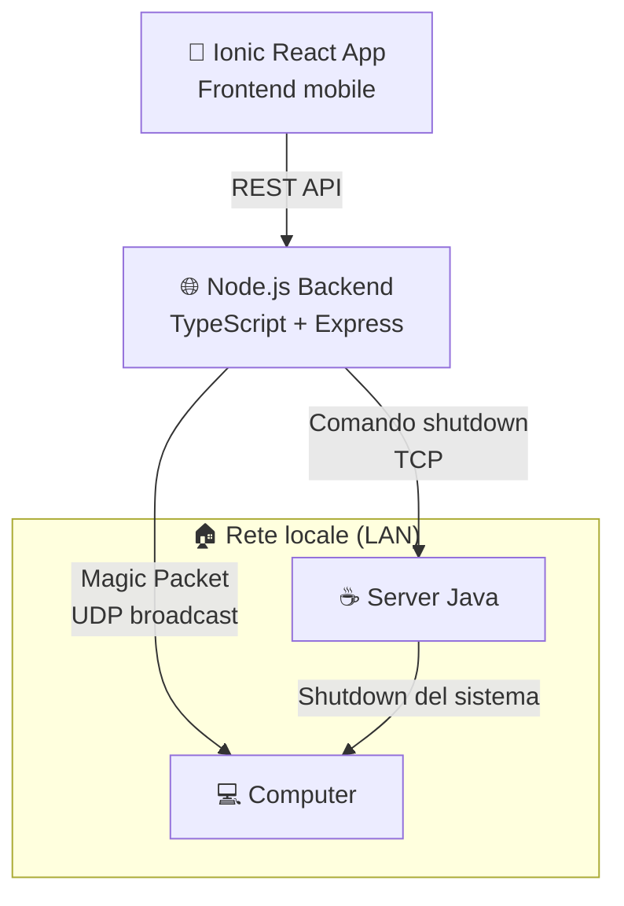
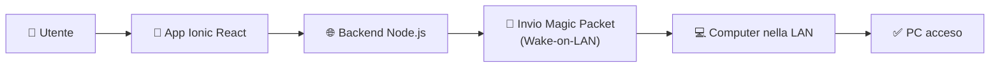
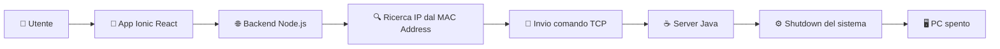

# 🚀 Wake On LAN Remote Manager

**Accendi e spegni i tuoi computer da remoto, direttamente dallo smartphone.**

---

# 📖 Overview

**Wake On LAN Remote Manager** è un progetto personale che permette di **accendere e spegnere un computer della propria rete LAN anche quando ci si trova fuori casa**, senza utilizzare software di desktop remoto.

L'accensione sfrutta il protocollo **Wake-on-LAN (WOL)**, mentre lo spegnimento è gestito da un piccolo **server Java installato sul PC remoto**.

L'obiettivo è offrire un'interfaccia semplice e sicura per amministrare i propri dispositivi da remoto.

---

# ✨ Funzionalità

- ⚡ Accensione remota tramite Wake-on-LAN
- 🖥️ Spegnimento remoto del PC
- 📱 Interfaccia mobile sviluppata con Ionic React
- 🌐 Backend REST sviluppato in Node.js / TypeScript
- 💾 Gestione dei dispositivi tramite MAC Address
- 🔄 Aggiornamento automatico dell'associazione MAC → IP
- 🔒 Accesso protetto da autenticazione

---

# 🏗️ Architettura

Il progetto è composto da tre componenti principali.

| Componente | Tecnologia | Responsabilità |
|------------|------------|----------------|
| **Frontend** | Ionic React | Visualizza i dispositivi registrati Aggiunge un nuovo computer Accende e spegne un PC Autenticazione all'applicazione |
| **Backend** | Node.js + TypeScript (REST) | Gestione dell'autenticazione e dei computer registrati Invio del Magic Packet Wake-on-LAN Individuazione dell'IP partendo dal MAC Address Invio del comando di spegnimento al server Java |
| **Server Java** | Java (TCP) | Rimane in ascolto sulla rete locale Riceve il comando di spegnimento dal backend Esegue il comando di arresto del sistema operativo |

In questo modo il PC può essere spento anche quando non è presente alcun utente davanti alla macchina.

## 🔄 Aggiornamento automatico MAC → IP

L'indirizzo IP di un computer può cambiare nel tempo, rendendo fragile lo spegnimento remoto. Per evitare configurazioni manuali, ogni computer esegue uno script che:

1. effettua un **ping ogni 24 ore**;
2. aggiorna automaticamente la tabella ARP del server;
3. permette al backend di ricavare il nuovo indirizzo IP partendo esclusivamente dal MAC Address.

Il sistema continua così a funzionare anche dopo il rinnovo del DHCP, senza interventi manuali.

---

# ⚙️ Come funziona

## Accensione del PC

## Spegnimento del PC

---

# 🛠️ Tecnologie

| Tecnologia | Utilizzo |
|------------|----------|
| Ionic React | Frontend |
| React | UI |
| TypeScript | Frontend & Backend |
| Node.js | REST Backend |
| Express | API |
| Java | Server remoto |
| TCP | Spegnimento remoto |
| UDP | Wake-on-LAN |
| Windows Batch | Automazione |
| Wake-on-LAN | Accensione remota |

---

# 🎯 Obiettivi del progetto

Questo progetto nasce con l'obiettivo di approfondire diversi aspetti dello sviluppo software, tra cui:

- progettazione di architetture client/server;
- sviluppo Full Stack;
- networking TCP/UDP;
- protocolli Wake-on-LAN;
- automazione tramite script;
- comunicazione tra applicazioni distribuite;
- progettazione di API REST.

---

# 📦 Installazione

Per la configurazione completa del progetto è disponibile la guida dedicata:

👉 **[HowToInstall.md](./HowToInstall.md)**

La guida contiene tutte le istruzioni per installare il frontend, configurare backend e server Java, installare gli script di supporto e preparare l'ambiente.

---

# 📄 Licenza

This work is licensed under a
[Creative Commons Attribution-NonCommercial-ShareAlike 4.0 International License][cc-by-nc-sa].

[![CC BY-NC-SA 4.0][cc-by-nc-sa-image]][cc-by-nc-sa]

[cc-by-nc-sa]: http://creativecommons.org/licenses/by-nc-sa/4.0/
[cc-by-nc-sa-image]: https://licensebuttons.net/l/by-nc-sa/4.0/88x31.png
[cc-by-nc-sa-shield]: https://img.shields.io/badge/License-CC%20BY--NC--SA%204.0-lightgrey.svg